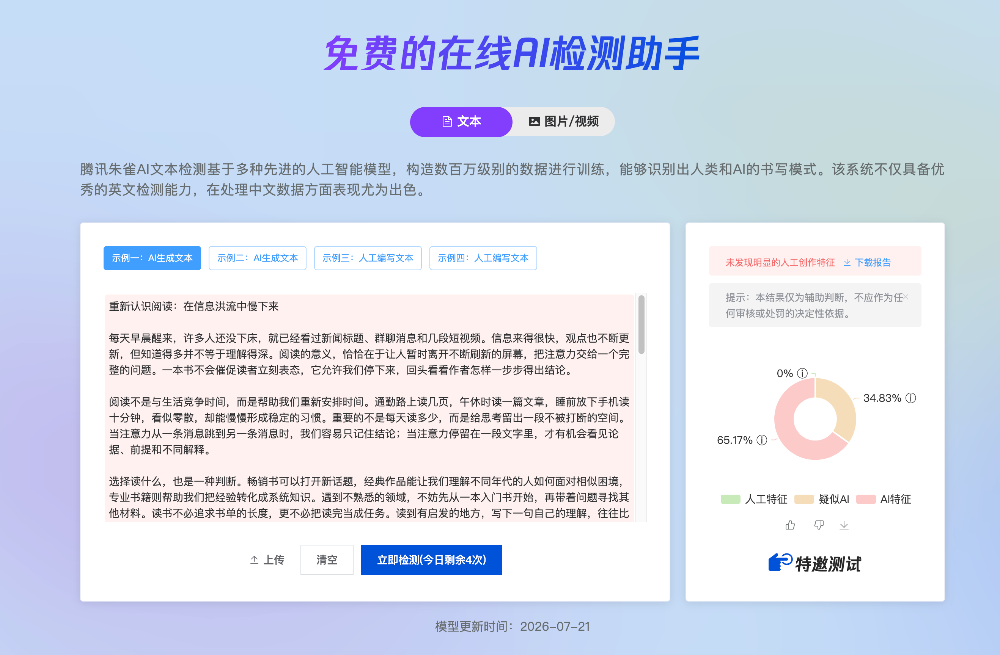
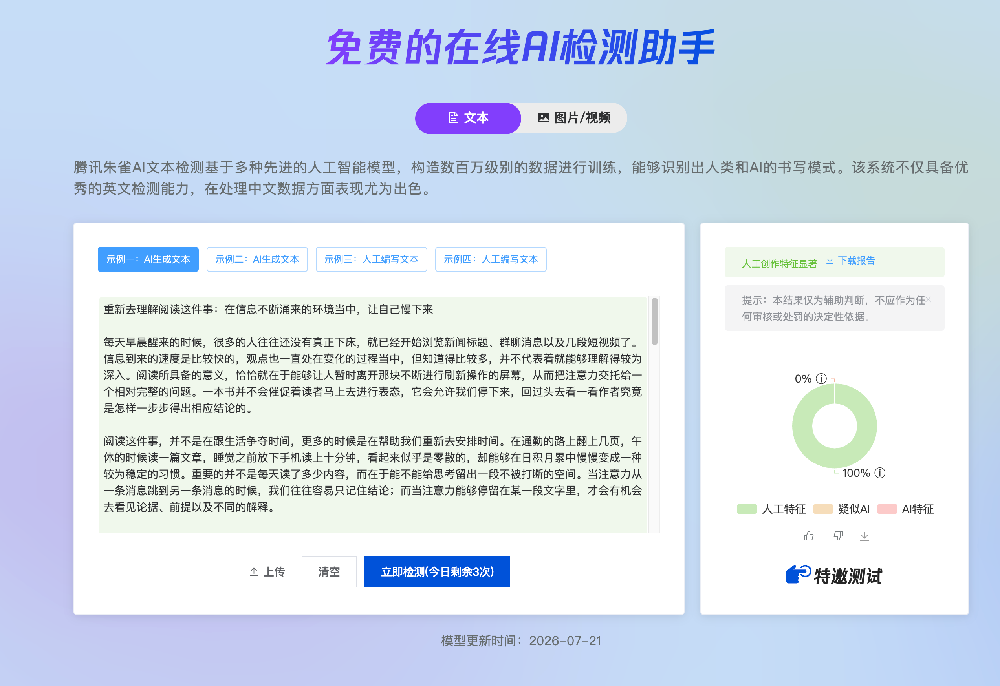
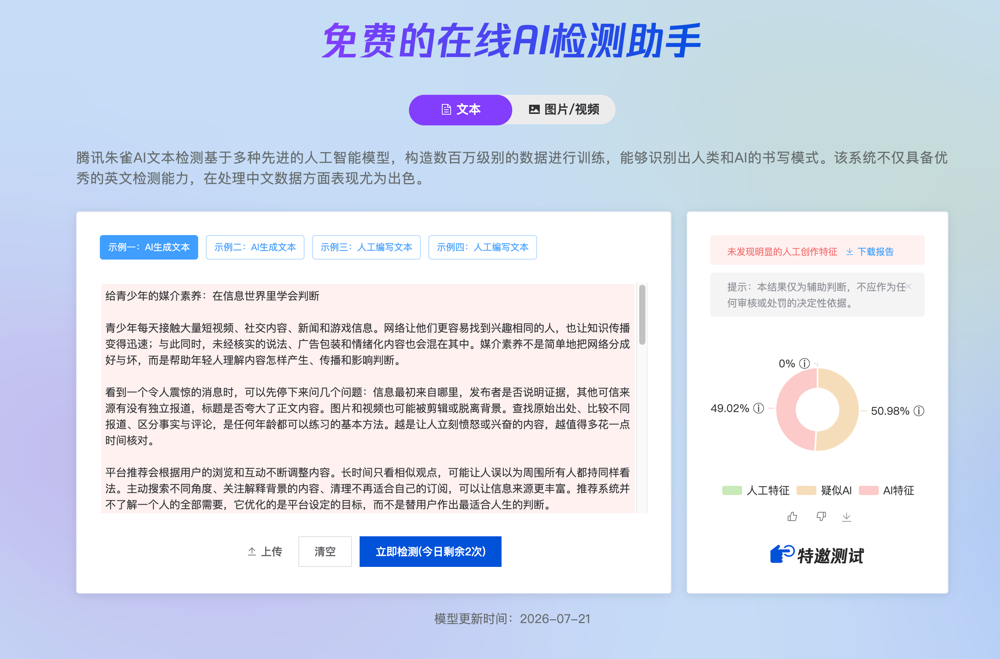
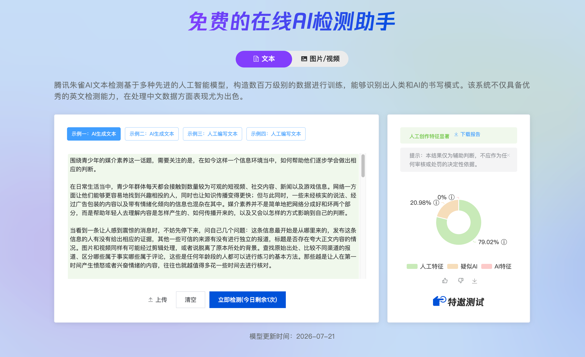

# 文章去AI味 · 器灵

## 挑战全网去 AI 味 Skills

一年研究，百万次改文积累。器灵邀请所有去 AI 味 Skills，用腾讯朱雀检测结果正面交锋。

同一篇原文，同一个检测平台。改完直接测，原文、改文、检测截图全部摆上桌。

欢迎带上你认为最强的 Skill。谁的效果更强，让结果说话。

**新用户可免费试用。拿你自己的文章来，亲自验。**

## 腾讯朱雀实测

以下是器灵提供的完整原文、接口改文与检测截图。指标按朱雀显示的三个类别分别记录。

| 案例 | AI 特征（改前 → 改后） | 疑似 AI（改前 → 改后） | 人工特征（改前 → 改后） |
|---|---:|---:|---:|
| [重新认识阅读](examples/reading/before.md) | 65.17% → **0%** | 34.83% → 0% | 0% → **100%** |
| [青少年媒介素养](examples/media-literacy/before.md) | 49.02% → **0%** | 50.98% → 20.98% | 0% → **79.02%** |

两篇改文的检测结论均为 **“人工创作特征显著”**。

### 重新认识阅读

[查看完整原文](examples/reading/before.md) · [查看完整改文](examples/reading/after.md)

| 改前 | 改后 |
|---|---|
|  |  |

### 青少年媒介素养

[查看完整原文](examples/media-literacy/before.md) · [查看完整改文](examples/media-literacy/after.md)

| 改前 | 改后 |
|---|---|
|  |  |

截图显示的朱雀模型更新时间为 2026-07-21。[打开腾讯朱雀自行复测](https://matrix.tencent.com/ai-detect/ai_gen)。

## 新用户免费体验

新用户可获得平台发放的免费改文次数，目前赠送 5 次，具体以平台实际权益为准。免费权益可直接用于 API 调用；用完后按平台实际价格计费。

改文通过器灵服务处理，正文会发送到 `https://toolsoul.daniu7.cn`。超出单次 2000 字符上限的文章会分段处理，调用次数在提交前展示。

## 安装与首次接入

### 安装

```sh
npx skills add qilingAI/qiling-humanize --skill qiling-humanize
```

技能文件使用标准 `SKILL.md`，调用脚本只依赖 Python 3 标准库。

### 一键授权：待接入

目标体验是 **打开器灵授权页并登录 → 自动创建或复用默认 API Key → 回传并保存到本地 → 开始改文**。

平台默认 Key 的创建与复用已有实现；浏览器授权页、回传协议和 Skill 自动保存的完整链路仍待完成。[查看接入设计](references/authorization.md)。

### 当前可用的兼容配置

登录[器灵 API Key 页面](https://toolsoul.daniu7.cn/account/api-keys)，查看已有默认 Key；在自己的本地交互终端、技能目录下执行：

```sh
python3 scripts/humanize.py configure
```

终端会隐藏密钥输入，并将配置保存在当前用户私有的本地文件中。也支持已有的 `QILING_API_KEY` 环境变量，环境变量优先。

密钥不需要发送到聊天中，也不要写入这个仓库。

## 使用

安装并完成配置后，在对话中说：

> 使用 qiling-humanize，给这篇文章去 AI 味，返回完整改文。

或指定本地文件：

> 使用 qiling-humanize 处理 article.md，另存改文并保留原稿。

脚本也可直接使用：

```sh
python3 scripts/humanize.py plan --input article.md
python3 scripts/humanize.py rewrite --input article.md --output article.humanized.md
```

`plan` 只计算字符和调用次数，不发请求。`rewrite` 保存任务 ID，查询原任务并交付服务成稿；实际扣费和余额来自接口响应。任务状态文件默认是 `article.humanized.md.qiling-state.json`，按私有文件保存且不会进入 Git。

中断后重新执行同一条 `rewrite` 命令即可继续。若提交结果尚未明确，先在[用量页](https://toolsoul.daniu7.cn/account/api-usage)核对，按脚本提示关联原任务；确认没有创建任务后才重新提交。完整恢复说明见 [SKILL.md](SKILL.md)。

[开放接口文档](https://toolsoul.daniu7.cn/account/api-docs?endpoint=remove_ai) · [本技能使用的接口说明](references/api.md)

## 本地验证

```sh
python3 -m unittest discover -s tests -v
```

测试使用模拟接口验证调用、分段、恢复和凭据保护，不产生平台调用费用。
